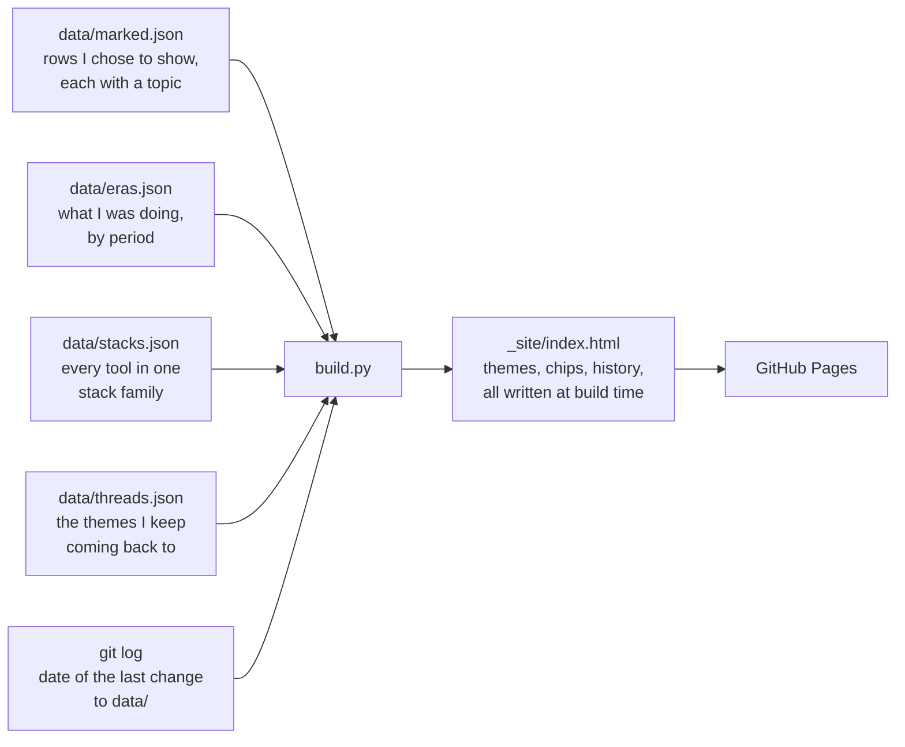

# BNI Tech

The source of [bnitech-lab.github.io](https://bnitech-lab.github.io): my lab, with every idea,
work and note since 2011, from my first game to what I am working on today.

BNI Tech is the name I put on my first games in 2011. It is not a company.

## How the page is made



1. `data/marked.json` holds the rows I chose to show, by the year they started. My full list of
   ideas lives elsewhere and never enters this repository. A row is either `public` (title,
   stack, stage, dates, an optional one-line summary and repository) or `private` (a code name,
   title, stack, stage and dates only). Every row has a `topic`, one of six: `games`, `apps`,
   `web`, `ai`, `study` or `life`. An optional `kind` of `contribution` (my part in someone
   else's work) or `note` (writing or study, not software) adds a small tag after the title.
   An optional `adopted` (`YYYY` or `YYYY-MM`) marks an idea I chose at an idea meeting, where
   AI personas argue an idea out with me ([persona-debate-lab](https://github.com/bnivibe/persona-debate-lab)).
   It adds a `meeting` tag and a line on the detail card. An optional `threads` list names the
   recurring themes a row belongs to (keys from `data/threads.json`; a row may name more than one).
2. `data/eras.json` says what I was doing in each period (studying where, working where, or on
   my own projects). The History shows a header for each period that has rows, newest first,
   with one line per year under it. A row goes under the period that holds its start month. If
   no period holds that month, it goes under "Between school and work". A row that gives only a
   year goes under the period that covers the most months of that year, but only if that is
   more months than no period covers. In 2018, Chung-Ang covers two months, Nexon one, and nine
   are in no period, so the two rows that give only "2018" go under "Between school and work".
   An open year lists its rows by stage: finished, running, stopped, retired, planned, idea. One
   calendar year opens at a time, even when two periods share it.
3. `data/stacks.json` puts every tool name a row lists into one stack family: "Java" and
   "Spring Boot" both sit under "Java and Spring". A tool belongs to exactly one family.
4. `data/threads.json` lists the themes I keep coming back to, each with a key, a name and a few
   words. A theme shows at the top of the page once its rows started in three or more separate
   years; rows adopted at an idea meeting draw but do not count toward the three years. Each theme
   is one line of year cells (yellow running, filled finished or retired, hollow otherwise, a
   number when a year holds more than one row) and opens to its tries in order. Only start years
   count; a restart shows on the row's own card. A row that shares a theme's word without naming
   the theme gets a "thread?" line in the build log, as a hint only.
5. `build.py` reads those four files and writes the whole page as static HTML with `page.html`
   as the template: the recurring themes, the By topic and By stack chips, the History
   and a detail card for every row. It makes no network call and needs no token. It also asks
   git for the date of the last commit that touched `data/`, in UTC like the "page built" date,
   and shows it in the footer as "Data changed". On a shallow checkout that date would be wrong, so
   the build fails instead.
6. The small script inside `page.html` only opens and closes one year or one card at a time, and
   filters by the picked chip. It never creates rows. With JavaScript off, every year and every
   card is open. The By topic chips show and do nothing, and the By stack chips and the family
   boxes stay hidden.
7. A GitHub Action rebuilds and publishes the page on every push to `main`, and also once a day
   on a schedule. Its checkout fetches full history, for the date above. A second workflow runs
   the tests, `--check` and a build on every pull request.

`python3 build.py --check` validates the data and writes nothing. Among other things, it rejects:

- a row with a field it is not allowed to have, a `kind` that is not `project`, `contribution`
  or `note`, and a `topic` that is missing or not one of the six;
- an era without a `label`, or with a `from` or `to` that is not `YYYY` or `YYYY-MM`;
- a tool name used by a row that no family holds, a tool listed in two families, and a family
  without a name or tools;
- a theme without a key of lowercase letters, digits or hyphens, without a name, with a field
  other than `key`, `name` and `words`, or used twice, and a row that names a theme nobody listed.

The build log can also print `still running? <title> (as_of <date>)`. It does that for a running
row with no repository whose `as_of` is more than 12 months old, so I can see which "running"
claims I should look at again. It does not fail the build and nothing appears on the page.
Next to it, `thread? <title> shares '<word>' with thread <key>` names a row that may belong to a
theme but does not say so; I tag it in a data PR or leave it.

## Run it

```bash
python3 -m unittest discover -s tests
python3 build.py --check
python3 build.py          # writes _site/index.html
```

Python standard library only, and no network. The build needs a git checkout with full
history, because it reads the date of the last change to `data/` from git.

## Known limits

- GitHub turns off a workflow that has a schedule after 60 days without activity in a public
  repository. It then does not run at all, on a push either, until I enable it again in the
  Actions tab or with `gh workflow enable pages.yml`.
- A running idea without a repository stays "running" until I change its row. The only sign is
  the `still running?` line in the build log.
- A hash link opens one year (`#2026`) or picks one filter (`#topic=ai`,
  `#stack=java-and-spring`), not both at once.

## Licence

MIT, see [LICENSE](LICENSE).
