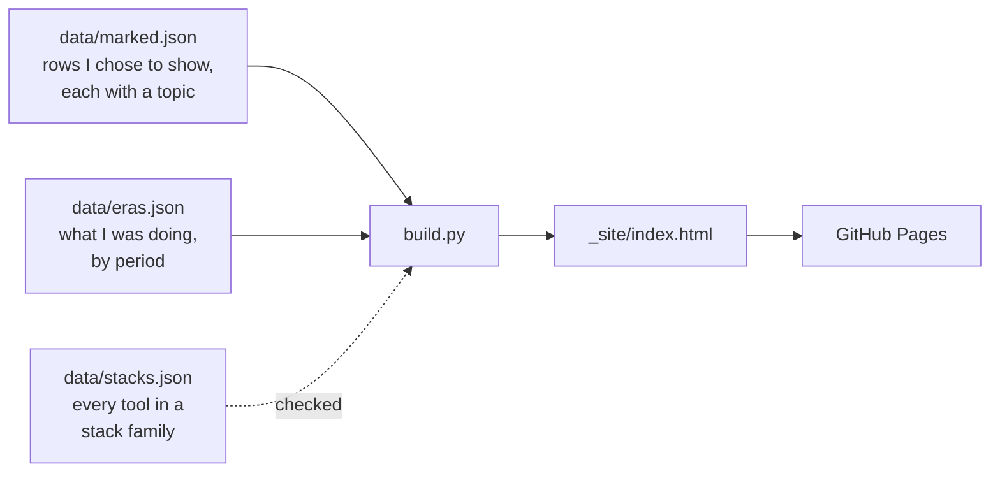

# BNI Tech

The source of [bnitech-lab.github.io](https://bnitech-lab.github.io): my lab, with every idea,
work and note since 2011, from my first game to what I am working on today.

BNI Tech is the name I put on my first games in 2011, one for each language I learned. It is
not a company.

## How the page is made



1. `data/marked.json` holds the rows I chose to show, by the year they started. My full list of
   ideas lives elsewhere and never enters this repository. A row is either `public` (title,
   stack, stage, dates, an optional one-line summary and repository) or `private` (a code name,
   title, stack, stage and dates only). Every row has a `topic`, one of six: `games`, `apps`,
   `web`, `ai`, `study` or `life`. An optional `kind` puts a row under a year's "Contributions"
   (my part in someone else's work) or "Ideas and notes" (writing or study, not software); rows
   that were only thought of or planned go under "Ideas and notes" on their own.
   `build.py --check` rejects any other field, kind or topic, and a row with no topic. Within a
   year the order is finished, running, stopped, retired, planned, thought; a row's summary opens
   on a tap, so the list stays short.
2. `data/eras.json` says what I was doing in each period (studying where, working where, or on
   my own projects), and the page prints it beside every year the period touches, with the
   months when a period starts or ends inside that year. `build.py --check` checks it too.
3. `data/stacks.json` puts every tool name a row lists into one stack family: "Java" and
   "Spring Boot" both sit under "Java and Spring". A tool belongs to exactly one family.
   `build.py --check` fails when a row uses a tool that no family holds, so a new spelling
   cannot slip in unnoticed.
4. There are no cards and no GitHub API calls. The build reads only the files in this
   repository, so it runs offline and needs no token. A GitHub Action rebuilds and publishes the
   page on every push, and also once a day on a schedule.

## Run it

```bash
python3 -m unittest discover -s tests
python3 build.py --check
python3 build.py          # writes _site/index.html
```

Python standard library only, and no network.

## Known limits

- GitHub turns off scheduled workflows in a public repository after 60 days without activity.
  If that happens, the daily rebuild stops until the next push or a manual run.
- A running idea without a repository shows the month it was last checked, which only moves
  when I update its row.

## Licence

MIT, see [LICENSE](LICENSE).
