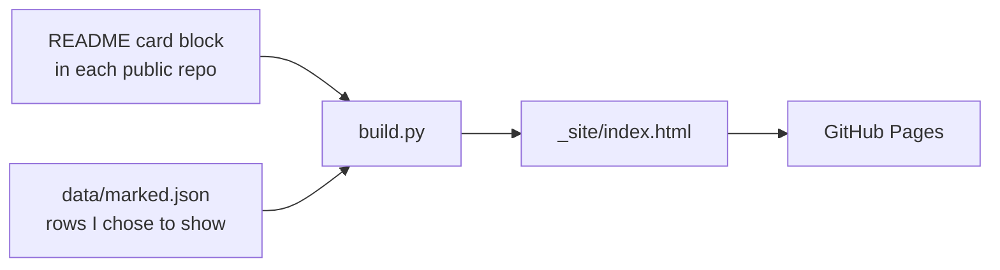

# BNI Tech

The source of [bnitech-lab.github.io](https://bnitech-lab.github.io): ideas I have built and
kept running, each one something you can try on your own in minutes.

BNI Tech is the name I put on my first games in 2011, one for each language I learned. It is
not a company.

## How the page is made



1. `data/cards.json` lists the repositories shown under "Try one". Each of them has a card at
   the top of its README, between `<!-- bnitech:card -->` and `<!-- /bnitech:card -->`: the
   problem, who it helps, and how to try it with a rough time. To change a card, edit those
   lines in that repository; the next build picks them up.
2. A repository gets a card only if a stranger can run it from its README alone, without me
   and without a server of mine. There are no "coming soon" cards.
3. `data/marked.json` holds the ideas I chose to show by year. My full list of ideas lives
   elsewhere and never enters this repository. A row is either `public` (title, stack, stage,
   dates, an optional one-line summary and repository) or `private` (a code name, title, stack,
   stage and dates only). An optional `kind` puts a row under a year's "Contributions" (my part
   in someone else's work) or "Ideas and notes" (writing or study, not software); rows that were
   only thought of or planned go under "Ideas and notes" on their own. `build.py --check`
   rejects any other field or kind. Within a year the order is finished, running, stopped,
   retired, planned, thought; a row's summary opens on a tap, so the list stays short.
4. `data/eras.json` says what I was doing in each period (studying where, working where, or on
   my own projects), and the page prints it beside every year the period touches, with the
   months when a period starts or ends inside that year. `build.py --check` checks it too.
5. A GitHub Action rebuilds the page on every push and once a day, so the last-commit dates
   stay current with nothing to run on my side.

## Run it

```bash
python3 -m unittest discover -s tests
python3 build.py --check
python3 build.py          # fetches the cards from GitHub, writes _site/index.html
```

Python standard library only. Set `GITHUB_TOKEN` for a higher API rate limit.

## Known limits

- GitHub turns off scheduled workflows in a public repository after 60 days without activity.
  If that happens, the daily rebuild stops until the next push or a manual run.
- A running idea without a repository shows the month it was last checked, which only moves
  when I update its row.

## Licence

MIT, see [LICENSE](LICENSE).
