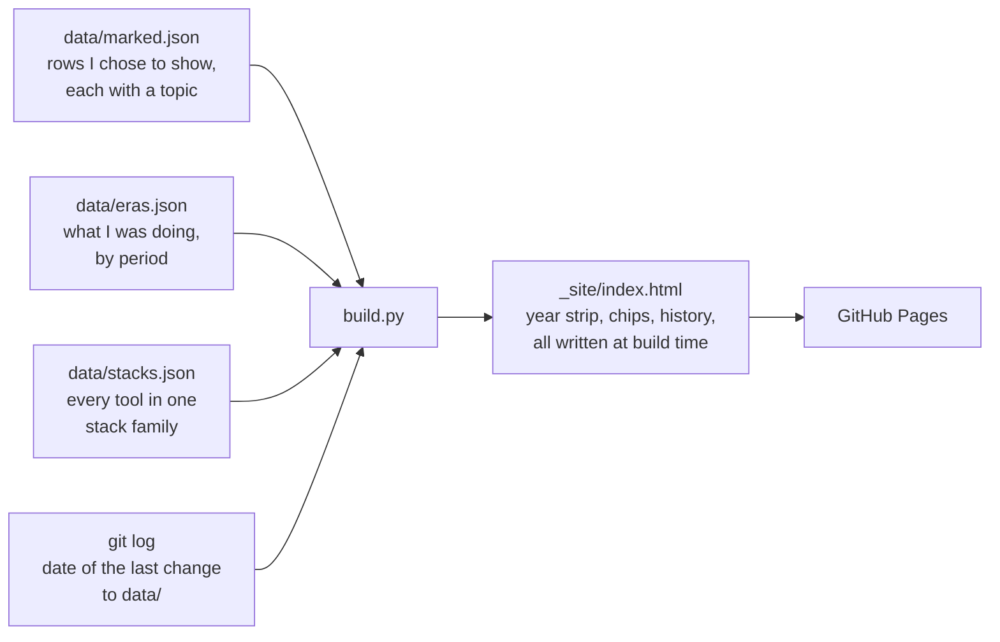

# BNI Tech

The source of [bnitech-lab.github.io](https://bnitech-lab.github.io): my lab, with every idea,
work and note since 2011, from my first game to what I am working on today.

BNI Tech is the name I put on my first games in 2011. It is not a company.

## How the page is made



1. `data/marked.json` holds the rows I chose to show, by the year they started. My full list of
   ideas lives elsewhere and never enters this repository. A row is either `public` (title,
   stack, stage, dates, an optional one-line summary and repository) or `private` (a code name,
   title, stack, stage and dates only). Every row has a `topic`, one of six: `games`, `apps`,
   `web`, `ai`, `study` or `life`. An optional `kind` of `contribution` (my part in someone
   else's work) or `note` (writing or study, not software) adds a small tag after the title.
2. `data/eras.json` says what I was doing in each period (studying where, working where, or on
   my own projects). The History shows one header per period, newest first, with one line per
   year under it. A row goes under the period that holds its start month (a row that gives only
   a year goes under the period that covers most of that year). An open year lists its rows by
   stage: finished, running, stopped, retired, planned, idea. One calendar year opens at a time,
   even when two periods share it. A year that falls in no period is shown under "Between
   school and work".
3. `data/stacks.json` puts every tool name a row lists into one stack family: "Java" and
   "Spring Boot" both sit under "Java and Spring". A tool belongs to exactly one family.
4. `build.py` reads those three files and writes the whole page as static HTML with `page.html`
   as the template: the year strip with its legend, the By topic and By stack chips, the History
   and a detail card for every row. It makes no network call and needs no token. It also asks
   git for the date of the last commit that touched `data/`, shown on the page as "Data
   changed" beside the "page built" date. On a shallow checkout that date would be wrong, so
   the build fails instead.
5. The small script inside `page.html` only opens and closes one year or one card at a time, and
   filters by the picked chip. It never creates rows. With JavaScript off, every year and every
   card is open and the chips do nothing.
6. A GitHub Action rebuilds and publishes the page on every push to `main`, and also once a day
   on a schedule. Its checkout fetches full history, for the date above. A second workflow runs
   the tests, `--check` and a build on every pull request.

`python3 build.py --check` validates the data and writes nothing. It rejects:

- a row with a field it is not allowed to have, a `kind` that is not `project`, `contribution`
  or `note`, and a `topic` that is missing or not one of the six;
- an era without a `label`, or with a `from` or `to` that is not `YYYY` or `YYYY-MM`;
- a tool name used by a row that no family holds, a tool listed in two families, and a family
  without a name or tools.

The build log can also print `still running? <title> (as_of <date>)`. It does that for a running
row with no repository whose `as_of` is more than 12 months old, so I can see which "running"
claims I should look at again. It does not fail the build and nothing appears on the page.

## Run it

```bash
python3 -m unittest discover -s tests
python3 build.py --check
python3 build.py          # writes _site/index.html
```

Python standard library only, and no network. The build needs a git checkout with full
history, because it reads the date of the last change to `data/` from git.

## Known limits

- GitHub turns off scheduled workflows in a public repository after 60 days without activity.
  If that happens, the daily rebuild stops until the next push or a manual run.
- A running idea without a repository stays "running" until I change its row. The only sign is
  the `still running?` line in the build log.
- A hash link opens one year (`#2026`) or picks one filter (`#topic=ai`,
  `#stack=java-and-spring`), not both at once.

## Licence

MIT, see [LICENSE](LICENSE).
